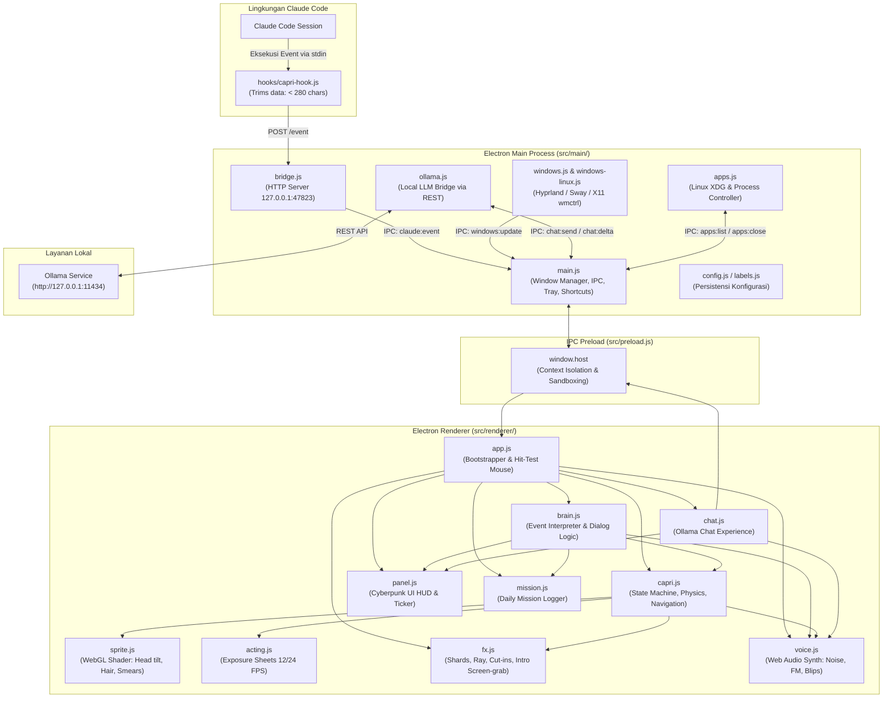
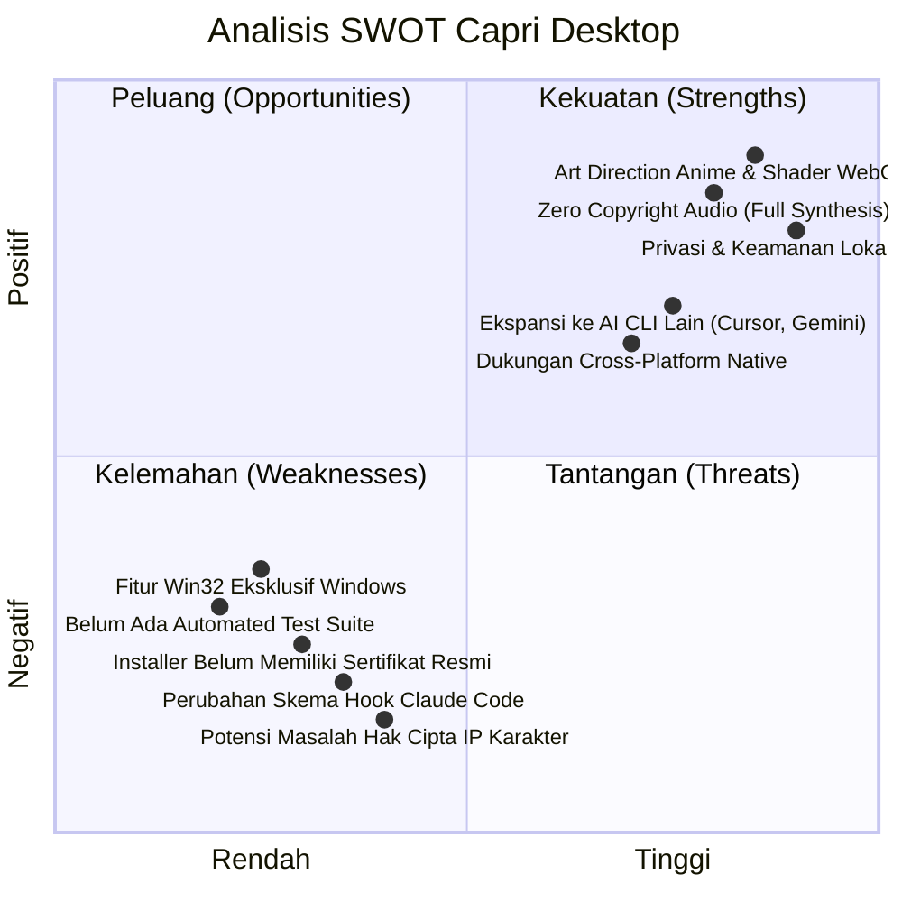

# Analisis Mendalam Proyek: Capri Desktop (`capri-desktop`)

> **Versi Analisis:** 1.0  
> **Tanggal:** 26 Oktober 2026  
> **Target Proyek:** `capri-desktop` (v0.3.2)  
> **Lisensi:** MIT (Perangkat Lunak) / Aset Karakter © CD PROJEKT RED & Studio Trigger  

---

## 1. Ringkasan Eksekutif (Executive Summary)

**Capri Desktop** adalah aplikasi *desktop companion / desktop pet* interaktif berbasis **Electron** yang dirancang dengan estetika anime *Cyberpunk: Edgerunners* (khususnya terinspirasi oleh karakter Capri dari *Project Capricorn*). Fungsi utamanya adalah menjadi pendamping visual cerdas yang merefleksikan, mengomentari, dan menarasikan aktivitas dari **Claude Code** (asisten *coding agent* dari Anthropic) secara *real-time* langsung di atas layar desktop pengguna.

Aplikasi ini melampaui *desktop pet* konvensional dengan mengintegrasikan:
1. **Rendering Grafis Bergaya Cel-Animation Tingkat Lanjut**: Animasi *pose-to-pose* tanpa interpolasi halus (*tweening*) bergaya Studio Trigger yang digerakkan sepenuhnya oleh **WebGL Fragment Shader** pada satu *texture quad*.
2. **Audio Sintetik Real-Time**: 100% efek suara dihasilkan langsung saat runtime menggunakan **Web Audio API** tanpa menggunakan sampel suara eksternal berhak cipta.
3. **Integrasi Window Manager Windows (Win32 API)**: Kemampuan duduk di atas bingkai jendela aplikasi aktif (*window perching*), jatuh jika jendela ditutup, dan "merasuk" (*possessing*) jendela dengan efek *glitch*.
4. **Chatbot AI Lokal (Ollama)**: Dialog interaktif *in-character* berbasis model AI lokal (*offline*) yang memahami konteks pekerjaan Claude dan status sistem.
5. **Privasi & Keamanan Ketat**: Tidak ada data sensitif (isi file, kode, atau token) yang keluar dari komputer pengguna (`127.0.0.1` loopback only).

---

## 2. Arsitektur Sistem & Alur Kerja (System Architecture)

Sistem dibangun dengan arsitektur modular yang memisahkan *data collection* (hook eksternal), *event routing & OS interaction* (Electron Main Process), dan *presentation/rendering* (Electron Renderer Process).

### 2.1 Diagram Alur Data Komprehensif



---

## 3. Rincian Komponen Utama (Component Deep-Dive)

### 3.1 External Hook (`hooks/capri-hook.js` & `scripts/install-hooks.js`)
* **Mekanisme**: Claude Code memiliki mekanisme hook event lifecycle (`SessionStart`, `UserPromptSubmit`, `PreToolUse`, `PostToolUseFailure`, `Notification`, `Stop`, dll.).
* **Prinsip Non-Bloking**: Script hook dirancang dengan aturan *"never get in Claude's way"*. Diberi batas waktu eksekusi ketat (timeout 800 ms) dan selalu keluar dengan *exit code 0* agar tidak pernah menggagalkan atau memperlambat pekerjaan Claude.
* **Penyaringan & Sanitasi Data**: Isi kode, patch diff, dan konten file tidak pernah dikirim ke Capri. Hook hanya mengambil nama tool (misal `Bash`, `Edit`, `Grep`), path berkas, dan memotong string panjang maksimal 280 karakter. Respons Claude dibatasi maksimal 6.000 karakter untuk ditampilkan di panel.
* **Installer Otomatis**: `install-hooks.js` melakukan modifikasi aman pada `~/.claude/settings.json`, secara otomatis membuat backup bertanggal sebelum mengubah konfigurasi.

### 3.2 Main Process (`src/main/`)
* **`main.js`**: Mengelola jendela transparan *full-screen*, *frameless*, dan *always-on-top* dengan level `screen-saver`. Memiliki fitur *smart click-through* (`setIgnoreMouseEvents(true, { forward: true })`) sehingga pengguna tetap bisa mengklik aplikasi di bawahnya secara normal kecuali kursor menyentuh tubuh Capri atau panel UI.
* **`bridge.js`**: Menjalankan server HTTP ringan di `127.0.0.1:47823`. Dilengkapi proteksi keamanan: menolak permintaan apapun yang memiliki header `Origin` (mencegah *cross-origin puppeting* dari situs web di peramban).
* **`windows.js` & `windows-linux.js`**: Menggunakan detektor jendela native Linux yang mendukung Hyprland (`hyprctl`), Sway (`swaymsg`), dan X11 (`wmctrl` & `xprop`). Menghasilkan koordinat jendela aplikasi aktif setiap 250 ms secara efisien tanpa memerlukan PowerShell.
* **`ollama.js`**: Menjembatani komunikasi dengan model bahasa lokal melalui API Ollama. Menyediakan fitur *model warming* (`keep_alive: 15m`) agar respon awal tidak mengalami *cold-start delay*, serta mendukung *streaming response*.
* **`apps.js`**: Fitur pencarian, pembukaan, dan penutupan aplikasi berbasis standar Linux XDG Desktop (`/usr/share/applications`, `~/.local/share/applications`), `gtk-launch`, `wmctrl`, dan `pkill`.

### 3.3 Renderer Process & Grafis WebGL (`src/renderer/`)
* **`sprite.js` (WebGL Custom Shader)**:
  Salah satu pencapaian teknis paling impresif dalam proyek ini. Alih-alih menggunakan ratusan sprite frame animasi (*spritesheet* berukuran raksasa) atau model 3D berat, animasi Capri digerakkan oleh **satu shader fragmen WebGL** di atas satu tekstur dasar (`capri-full.png` 240x420 px):
  - *Head Tilt & Mane Flare*: Perhitungan rotasi matriks 2D pada koordinat leher dan kepala.
  - *Symmetrical Claws*: Lengan kanan dibuat dengan mencerminkan lengan kiri secara matematis dalam shader, menjaga konsistensi gaya visual.
  - *Line Boil*: Pengacakan noise per-frame yang menghasilkan efek getaran garis pensil gambar tangan khas animasi klasik.
  - *Relic Glitch & Chromatic Aberration*: Pembagian fragmen horizontal RGB split dan bayangan ungu (*violet misregistration*) yang merefleksikan estetika *cyberware malfunction* di dunia Cyberpunk.
  - *Squash & Stretch*: Deformasi skala non-linear saat melompat, jatuh, dan mendarat.
* **`acting.js` (Anime Exposure Sheets)**:
  Animasi tidak menggunakan *tweening* matematis halus (seperti *cubic-bezier* CSS). Sebaliknya, menggunakan lembar eksposur (*X-sheet*) dengan kecepatan 12 fps atau 24 fps (konsep *"on twos"* dan *"on ones"* dalam animasi tradisional). Berisi definisi pose kunci untuk berbagai perilaku: `stand`, `sit`, `peek`, `fall`, `teleport`, `laugh`, `strike`, dan lain-lain.
* **`capri.js` (State Machine & Physics)**:
  Mengontrol kecerdasan buatan dan fisika pergerakan Capri: gravitasi akselerasi saat jatuh, deteksi benturan tepi jendela (*platform catching*), *wandering* santai, teleportasi ke posisi mouse saat Claude memerlukan persetujuan (*permission prompt*), hingga mode tidur (*sleep*) setelah 10 menit tanpa aktivitas.
* **`fx.js` (Visual Effect Layer)**:
  Kanvas efek 2D untuk elemen dramatis: kilatan petir merah, pancaran partikel pecahan (*shards*), garis kecepatan anime (*speed lines*), sekuens komunikasi satelit 5-tahap, intro *slam-on-screen*, dan *cut-in portrait* wajah Capri yang diambil dari adegan serial aslinya.
* **`voice.js` (Procedural Web Audio Engine)**:
  Seluruh efek audio (teleport, alert, done, blip berbicara, gemuruh petir, tawa) disintesis secara algoritmik menggunakan osilator, white noise buffer, filter biquad, dan modulasi frekuensi/gain. Tidak ada file `.wav`/`.mp3` bawaan, menghindarkan proyek dari pelanggaran hak cipta suara. Pengguna juga dapat memasang suara kustom di direktori `userData/sounds`.
* **`brain.js` & `panel.js`**:
  *Brain* bertindak sebagai penerjemah logis: menerima event Claude Code lalu menentukan reaksi emosional dan teks dialog Capri dalam 5 bahasa (Inggris, Prancis, Spanyol, Portugis, Rusia). *Panel* menampilkan balon percakapan bertema *HUD cyberware* lengkap dengan *ticker* status aktif Claude.

---

## 4. Analisis Keamanan & Privasi (Security & Privacy Assessment)

| Aspek Keamanan | Implementasi di Capri | Penilaian |
|---|---|---|
| **Kerahasiaan Data (Confidentiality)** | Data kode, isi file, dan rahasia proyek dieliminasi pada level hook (`capri-hook.js`). Hanya metadata (nama perintah, nama file terpotong, jumlah baris) yang dikirim. | **Sangat Baik** |
| **Isolasi Jaringan (Network Exposure)** | Server HTTP lokal diikat (*bind*) ketat ke `127.0.0.1`. Tidak ada transmisi keluar (*zero outbound telemetry*). | **Sangat Baik** |
| **Pencegahan Eksploitasi Web (Anti-CSRF)** | Request yang menyertakan header `Origin` langsung ditolak dengan status HTTP 403 Forbidden, mencegah manipulasi dari situs web peramban jahat. | **Sangat Baik** |
| **Sandboxing & Isolasi Renderer** | `contextIsolation: true`, `nodeIntegration: false`, `sandbox: true` diaktifkan pada BrowserWindow Electron. Komunikasi hanya melewati API terkurasi di `preload.js`. | **Sesuai Standar Industri** |
| **Interaksi OS & Eksekusi Proses** | Fitur penutupan aplikasi membatasi proses sistem (`KEEP` whitelist), mengecualikan sistem krusial, dan mewajibkan interaksi fisik klik tombol dari pengguna. | **Aman Terkendali** |
| **Integritas Konfigurasi** | Instalasi hook Claude membuat backup bertanggal (`settings.json.capri-backup-*`) sebelum melakukan modifikasi. | **Sangat Baik** |

---

## 5. Struktur Direktori Proyek

```
capri-desktop/
├── assets/                     # Aset gambar mentah, ikon, dan frame cut-in
│   ├── capri/                  # Tekstur sprite, cut-in, dan intro cels
│   └── icons/                  # Ikon aplikasi (.ico, .png)
├── docs/                       # Dokumentasi visual dan screenshot fitur
├── hooks/
│   └── capri-hook.js           # Script hook Claude Code (Node.js)
├── scripts/
│   ├── demo-sequence.js        # Timeline event untuk simulasi demo
│   ├── demo.js                 # Runner simulasi demo CLI
│   └── install-hooks.js        # Utilitas instalasi hook Claude Code
├── src/
│   ├── main/                   # Electron Main Process
│   │   ├── apps.js             # Pengendali daftar, peluncuran, & proses aplikasi Linux
│   │   ├── bridge.js           # Server HTTP lokal untuk menerima event
│   │   ├── config.js           # Penyimpanan konfigurasi JSON lokal
│   │   ├── labels.js           # Terjemahan tray menu (5 bahasa)
│   │   ├── main.js             # Entry point Electron, lifecycle, & overlay window
│   │   ├── ollama.js           # Integrasi API model AI lokal Ollama
│   │   ├── windows.js          # Pengelola watcher jendela Linux
│   │   └── windows-linux.js    # Tracker jendela native Linux (Hyprland, Sway, X11)
│   ├── preload.js              # IPC Bridge (contextBridge)
│   └── renderer/               # Electron Renderer Process (Frontend UI)
│       ├── index.html          # Shell HTML untuk overlay dan canvas
│       ├── js/                 # Logika presentasi, animasi, dan grafis
│       │   ├── acting.js       # Exposure sheet pose karakter
│       │   ├── app.js          # Bootstrapper frontend dan mouse tracker
│       │   ├── brain.js        # Logika interpretasi event Claude
│       │   ├── capri.js        # State machine fisik dan karakter Capri
│       │   ├── chat.js         # Dialog interaktif via Ollama
│       │   ├── chip.js         # Mode mask tidur dan biochip
│       │   ├── fx.js           # Sistem partikel 2D dan cinematic FX
│       │   ├── guide.js        # Tutorial interaktif dan penunjuk lokasi
│       │   ├── lines.js        # Bank dialog multibahasa (FR, EN, ES, PT, RU)
│       │   ├── mission.js      # Pelacak statistik harian Claude
│       │   ├── panel.js        # UI balon HUD dan ticker
│       │   ├── sprite.js       # WebGL fragment shader renderer
│       │   ├── util.js         # Fungsi pembantu matematika & format
│       │   └── voice.js        # Audio synthesizer Web Audio API
│       └── styles/
│           └── capri.css       # Desain visual bertema Cyberpunk/Trigger
├── tools/                      # Tool pengolahan aset berbasis Python + Pillow
│   ├── build-cutins.py         # Ekstraksi potret cut-in dari adegan
│   ├── build-intro.py          # Ekstraksi dan pembuatan cel intro
│   └── build-sprite.py         # Rekonstruksi tekstur sprite simetris
├── package.json                # Metadata dependensi & script proyek
├── README.md                   # Dokumentasi resmi (Bahasa Inggris)
├── README.fr.md                # Dokumentasi resmi (Bahasa Prancis)
└── LICENSE                     # Lisensi perangkat lunak (MIT)
```

---

## 6. Analisis SWOT (Kekuatan, Kelemahan, Peluang, Ancaman)



### 6.1 Kekuatan (Strengths)
1. **Art Direction & Desain Visual Luar Biasa**: Pendekatan *cel-animation* 12 fps dengan *exposure sheet* dan WebGL shader menghasilkan karakter yang terasa hidup dan sesuai jiwa anime aslinya, jauh lebih ekspresif daripada widget konvensional.
2. **Efisiensi Teknis**: Menggunakan satu tekstur quad WebGL dan sintesis audio runtime membuat ukuran aplikasi dan jejak memorinya sangat efisien.
3. **Privasi Tanpa Kompromi**: Pengolahan 100% lokal di loopback adapter tanpa pengumpulan telemetri atau pengiriman kode pengguna.
4. **Respon Cepat & Non-Intrusif**: Hook asinkron Claude dengan timeout cepat memastikan performa asisten koding tidak pernah terganggu.
5. **Dukungan Multibahasa Lengkap**: Tersedia dalam 5 bahasa utama dengan deteksi lokal otomatis.

### 6.2 Kelemahan (Weaknesses)
1. **Keterbatasan Platform (Windows-Centric)**: Fitur pelacakan jendela (*window perching*), penutupan aplikasi, dan integrasi PowerShell hanya berfungsi di Windows. Pada macOS dan Linux, fitur ini non-aktif.
2. **Ketergantungan Ekosistem**: Dirancang eksklusif untuk Claude Code, belum mendukung *coding tool* AI lainnya secara langsung.
3. **Tanpa Code-Signing Certificate**: Installer NSIS memicu peringatan Microsoft Defender SmartScreen bagi pengguna baru Windows.
4. **Minimnya Automated Test Suite**: Belum terdapat pengujian otomatis (*unit/integration tests*) untuk logika *state machine* atau shader.

### 6.3 Peluang (Opportunities)
1. **Dukungan Multi-Asisten**: Membuka arsitektur input (misalnya melalui webhook standar, stdin pipe, atau file watcher) agar dapat merespons asisten lain seperti **GitHub Copilot CLI**, **Aider**, **Cursor**, **Windsurf**, atau **Gemini CLI**.
2. **Cross-Platform Window Tracking**: Mengganti `windows.ps1` dengan modul native Node.js (misalnya `node-window-manager` atau pustaka C++ FFI) untuk mendukung macOS (Quartz/Accessibility API) dan Linux (X11/Wayland).
3. **Kustomisasi Karakter & Skin**: Memungkinkan arsitektur modular di mana pengguna dapat memuat karakter dan dialog lain menggunakan shader engine yang sama.

### 6.4 Tantangan & Risiko (Threats)
1. **Hak Cipta Karakter (Intellectual Property)**: Capri adalah karakter milik CD PROJEKT RED / Studio Trigger / Netflix. Meskipun proyek bersifat non-komersial, terdapat potensi klaim hak cipta atas aset visual.
2. **Perubahan Format Hook Claude Code**: Jika Anthropic mengubah format payload atau mekanisme hook event di masa mendatang, parser di `capri-hook.js` dan `brain.js` harus diperbarui.

---

## 7. Rekomendasi Pengembangan (Actionable Recommendations)

1. **Abstraksi Adapter AI Agent**:
   Buat antarmuka adapter generik (`src/main/adapters/`) yang memetakan event dari berbagai AI coding tool ke format event Capri yang seragam.
2. **Pengembangan Unit Test**:
   Tambahkan suite pengujian menggunakan Vitest atau Jest untuk memvalidasi:
   - Parser sanitasi hook di `capri-hook.js`.
   - Logika penanganan event dan pemilahan dialog di `brain.js`.
   - Perhitungan pose matematis di `acting.js`.
3. **Otomasi CI/CD & Build Release**:
   Tambahkan workflow GitHub Actions untuk *linting*, validasi build Electron di multi-OS, dan otomatisasi rilis tag installer.
4. **Penyempurnaan Integrasi Wayland & macOS**:
   Eksplorasi penggunaan pustaka deteksi jendela lintas platform untuk menghilangkan status *"Windows only"* pada fitur interaksi jendela.

---

## 8. Kesimpulan

Proyek **Capri Desktop** adalah perpaduan luar biasa antara rekayasa perangkat lunak sistem desktop (*Win32 API, Electron, IPC*), teknik grafis GPU canggih (*WebGL procedural fragment shader*), pemrosesan audio algoritmik (*Web Audio API*), dan kecerdasan buatan lokal (*Ollama*). 

Proyek ini berhasil mengubah aktivitas asisten koding CLI yang biasanya kaku dan hanya berupa teks di terminal menjadi pengalaman visual yang imersif, menyenangkan, dan berjiwa tanpa mengorbankan privasi pengguna sedikit pun.
